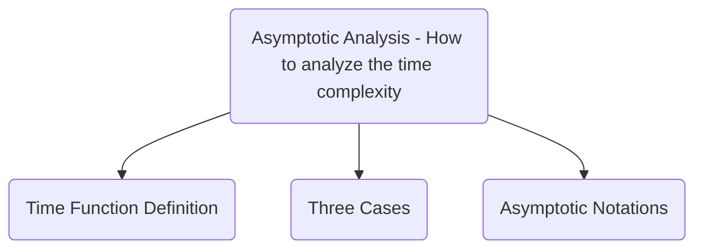

# Selection Sort Research Report

CSCI242 Fall 2026
authors: Tony White, Blake Wiemken
team: FirstTeam
algorithm: Selection Sort
date: 2026-10-23

## Executive Summary

Selection Sort is a very simple in-place sorting algorithm.   When compared with more modern sorting algorithms, it is seldom the ideal choice.   However, where Selection Sort shines is its minimal  number of required swap operations and its consistent number of comparison operations.

## History

Selection Sort is one of the oldest sorting algorithms in Computer Science.  Because of its simplicity, there is no known original author or documented first-use of the algorithm.   

## Use Cases

While not often used as a general purpose sorting algorithm in modern computing today, Selection Sort does still have its uses in both education and industry.  Due to the inherent simplicity of the algorithm, it is still widely used in Computer Science education.   While not as fast as other more modern sorting algorithms in terms of overall time-complexity, Selection Sort still has a real-world use on certain embedded systems that have very expensive memory write operations.  Because the values in the list will only ever be moved (swapped) a maximum of **one time** by the sorting algorithm, this gives Selection Sort an $O(n)$ time complexity it terms of swap operations.

## Comparison to Other Sorting Algorithms

By comparing Selection Sort to some other in-place sorting algorithms, we can clearly see  some important differences.  


### Comparison to Heap Sort

| Algorithm      | Big $O$     | Big $\Theta$ | Big $\Omega$ | Big $O$ (For Swaps) | Stable |
| -------------- | ----------- | ------------ | ------------ | ------------------- | ------ |
| Selection Sort | $n^2$       | $n^2$        | $n^2$        | $n$                 | No     |
| Heap Sort      | $nlogn$[^1] | $nlogn$      | $n log n$    | $nlogn$[^2]         | No     |

 Heap Sort is an in-place sorting algorithm invented in 1964[^1] by John William Joseph (Bill) Williams.  It has a distinct advantage over Selection Sort in that even its Worst Case time complexity is $O(nlogn)$.[^1]   Because Heap Sort uses the concept of a Binary Heap data structure, not every item in the list needs to be blindly looked at for each iteration.  This comparison strategy eliminates many of the iterations though the list that Selection Sort must complete in order to sort the list.

Although Heap Sort's Worst Case (Big $O$) (specifically for Swaps) stays in line with its overall time complexity of $O(nlogn)$, Selection Sort does have a clear advantage in this category.  Since Selection Sort can never move (a.k.a swap) any element more than 1 time during the sorting process $O(n)$, it may still be the better choice when memory write operations are a the primary bottleneck in the system.

Neither Selection Sort nor Heap Sort are **Stable** sorting algorithms.  This means that if the items to be sorted have equal values, there is no guarantee that the specific elements with the same value will retain their original order in the list.

<div style="page-break-after: always;"></div>

### Comparison to Insertion Sort
| Algorithm      | Big $O$ | Big $\Theta$ | Big $\Omega$ | Big $O$ (For Swaps) | Stable  |
| -------------- | ------- | ------------ | ------------ | ------------------- | ------- |
| Selection Sort | $n^2$   | $n^2$        | $n^2$        | $n$                 | No      |
| Insertion Sort | $n^2$   | $n^2$        | $n$[^3]      | $n^2$               | Yes[^4] |

Insertion Sort's history is similar to Selection Sort in that they both pre-date modern computing.  Like Selection Sort, Insertion Sort is a very simple algorithm.  It can be described as similar to the act of sorting a hand of playing cards by inserting one card at a time into your sorted set of cards until all the cards are part of the sorted set of cards.  

Both algorithms have the same Worst Case $O(n^2)$ and Average Case $\Theta(n^2)$, but where Insertion Sort has the advantage is the Best Case time complexity.  If the list is already sorted, time complexity is only $\Omega(n)$.

In terms of Worst Case specifically for Swap operations, Selection Sort is the clear winner.  Not many sorting algorithms have Worst Case time complexity as low as Selection Sort at $O(n)$.  Insertion Sort is the near polar-opposite with a Worst case time complexity for swaps at $O(n^2)$.

In terms of being **Stable**, these two algorithms are also very different.  Insertion sort is a **Stable** sorting algorithm, meaning that list elements with equal compared values retain their original position after sorting.  In reference to the earlier playing card analogy, this would mean that if given a hand containing three Jacks, the suits of those cards would remain in the original order after the sorting process.

## Algorithm

### <ins>Selection Sort</ins>

1. Iterate through the list `LIST` while storing the current item index as `CURRENT_IDX`.
2. Starting at the current item, iterate through the remaining items in the list to find the lowest value and store the index of that item as `LOWEST_IDX`
3. If the value stored in the current item does NOT have the lowest value of all the remaining items, then swap the values stored in the current item with the value stored at `LOWEST_IDX`.
    1. Copy the value of the list item stored at `CURRENT_IDX` index to `TEMP`.
        
        `TEMP = LIST[CURRENT_IDX]`
    1. Copy the value of the item at `LOWEST_IDX` to the item at `CURRENT`
        
        `LIST[CURRENT_IDX] = LIST[LOWEST_IDX]`
	1. Copy the value stored in `TEMP` to the item at `LOWEST_IDX`
        
        `LIST[LOWEST_IDX] = TEMP`

### Pseudocode

```
for CURRENT_IDX from 0 to length(LIST) do
    LOWEST_IDX <- CURRENT_IDX
    for SEARCH_IDX from CURRENT_IDX to length(LIST) do
        if LIST[SEARCH_IDX] < LIST[LOWEST_IDX] then
            LOWEST_IDX <- SEARCH_IDX
        endif
    endfor
    if LOWEST_IDX != CURRENT_IDX then
        TEMP <- LIST[CURRENT_IDX]
        LIST[CURRENT_IDX] <- LIST[LOWEST_IDX]
        LIST[LOWEST_IDX] <- TEMP
    endif
endfor
```

### Implementation Example (Python)

```python
def selection_sort():
    for c in range(len(LIST)):
        lowest_idx = c
        for s in range(c, len(LIST)):
            if LIST[s] < LIST[lowest_idx]:
                lowest_idx = s
        if lowest_idx != c:
            tmp = LIST[c]
            LIST[c] = LIST[lowest_idx]
            LIST[lowest_idx] = tmp
```


## Asymptotic Analysis



### Time Function Definition

```cpp
void T(int n[]) {                            // T(n)
    int i, j, tmp, lowest_idx;               // 4
    for (i = 0; i < sizeof(n); i++) {        // n + 1
        lowest_idx = i;                      // n
        for (j = i; j < sizeof(n); j++)      // n * (n + 1)
            if (n[j] < n[lowest_idx])        // n * n
                lowest_idx = j;              // n * n
        if (lowest_idx != i) {               // n
            tmp = n[i];                      // n
            l[i] = l[lowest_idx];            // n
            l[lowest_idx] = tmp;             // n
        }
    }
}
```

$T(n) = 4 + (n + 1) + n + (n * (n + 1)) + n^2 + n^2 + n + n + n + n$

$T(n) = 3n^2 + 7n + 5$

#### Asymptotic Analysis Rule #1

(keeping only term with highest degree)

$T(n) = 3n^2$

#### Asymptotic Analysis Rule #2

(ignore constants)

$T(n) = n^2$

<div style="page-break-after: always;"></div>

### Three Cases

#### Worst Case

The worst case for time complexity for this algorithm is when **the list is sorted, but in reverse order**.  This will require moving every element.  However, no matter if all the elements are moved or none of them are moved, the time complexity is $O(n^2)$ because of comparison operations.

$T(n) = 4 + (n + 1) + n + (n * (n + 1)) + n^2 + n^2 + n + n + n + n$

$T(n) = 3n^2 + 7n + 5$

$T(n) = 3n^2$

$T(n) = n^2$

See [Big O](#Big%20O) Below

#### Best Case

The best case for Time Complexity for this algorithm is when **the list is already sorted**.
This will not require moving any elements.  However the time complexity is still $O(n^2)$ because of comparison operations.

$T(n) = 4 + (n + 1) + n + (n * (n + 1)) + n^2 + n$

$T(n) = 2n^2 + 4n + 5$

$T(n) = 2n^2$

$T(n) = n^2$

See [Big Omega](#Big%20Omega)

#### Average Case

The average case for Time Complexity for this algorithm is when **the list is unsorted in such a way that half of items must move**.  The time complexity will always be $O(n^2)$ because of the comparison operations.

$T(n) = 4 + (n + 1) + n + (n * (n + 1)) + n^2 + \frac{n^2}{2} + n + \frac{n}{2} + \frac{n}{2} + \frac{n}{2}$

$T(n) = \frac{5n^2}{2} + \frac{11n}{2} + 5$

$T(n) = \frac{5n^2}{2}$

$T(n) = n^2$

See [Big Theta](#Big%20Theta)


### Asymptotic Notations

Time Complexity Key:

> [!NOTE]
> $1 <logn < \sqrt{n} < n < \dots < n^2 < n^3 < \dots < 2^n < 3^n < \dots < n^n$

<div style="page-break-after: always;"></div>

#### Big O

Worst Case: Reverse Sorted List

> [!TIP]
> The function $f(n) = O(g(n)) \iff \exists$ two Constants $C$ and $k$ such that:
>  $\quad f(n) <= C \cdot g(n) \quad \forall n >= k$

$3n^2 + 7n + 5 <= C \cdot g(n) \quad \forall n >= 1$

$3n^2 <= C \cdot g(n) \quad \forall n >= 1$

$n^2 <= C \cdot g(n) \quad \forall n >= 1$

$n^2 <= n^2$ where $C$ =1 and $g(n) = n^2$

From the definition: $O(n^2)$

#### Big Omega

Best Case: Sorted List

> [!TIP]
> The function $f(n) = \Omega(g(n)) \iff \exists$ two Constants $C$ and $k$ such that:
>  $\quad f(n) >= C \cdot g(n) \quad \forall n >= k$

$2n^2 + 4n + 5 >= C \cdot g(n) \quad \forall n >= 1$

$2n^2 >= C \cdot g(n) \quad \forall n >= 1$

$n^2 >= C \cdot g(n) \quad \forall n >= 1$

$n^2 >= n^2$ where $C$ =1 and $g(n) = n^2$

From the definition: $\Omega(n^2)$

#### Big Theta

Average Case: The list is unsorted in such a way that half of items must move.

> [!TIP]
> The function $f(n) = \Theta(g(n)) \iff \exists$  three Constants $C_1$, $C_2$, and $k$ such that:
>  $\quad C_1 \cdot g(n) <= f(n) <= C_2 \cdot g(n) \quad \forall n >= k$

$C_1 \cdot g(n) <= \frac{5n^2}{2} + \frac{11n}{2} + 5 <= C_2 \cdot g(n)$

$2n^2 + 4n + 5 <= \frac{5n^2}{2} + \frac{11n}{2} + 5 <= 3n^2 + 7n + 5$

$2n^2 <= \frac{5n^2}{2} <= 3n^2$

$\frac{4n^2}{5} <= n^2 <= \frac{6n^2}{5} \quad \forall n >= 1$ where $C_1 = \frac{4}{5}, C_2 = \frac{6}{5}$ and $g(n) = n^2$

From the definition: $\Theta(n^2)$

### Conclusion

With an exact bound of **quadratic time** time-complexity, Selection Sort is not often the first choice for a Sorting Algorithm in modern computing.  However, it still has very specific characteristics such as its static comparison and swap operations which keep it relevant.   Finally, the simplistic nature of the algorithm make it easy to understand and use.

[^1]: Williams, J. W. J. (1964). "Algorithm 232 - Heapsort". *Communications of the ACM*. **7** (6): 347–348. doi:10.1145/512274.512284.

[^2]: Cormen, T. H., Leiserson, C. E., Rivest, R. L., & Stein, C. (2022). *Introduction to Algorithms* (4th ed.). MIT Press. Chapter 6 (Heapsort) outlines that the `MAX-HEAPIFY` procedure takes $O(log n)$ time per element, which directly bounds both comparisons and exchanges (swaps) to a total of $O(n log n)$ during the sorting phase.

[^3]: Cormen, T. H., Leiserson, C. E., Rivest, R. L., & Stein, C. (2022). *Introduction to Algorithms* (4th ed.). MIT Press. Chapter 2 (Getting Started)

[^4]: Knuth, D. E. (1998). *The Art of Computer Programming: Volume 3: Sorting and Searching* (2nd ed.). Addison-Wesley Professional.
