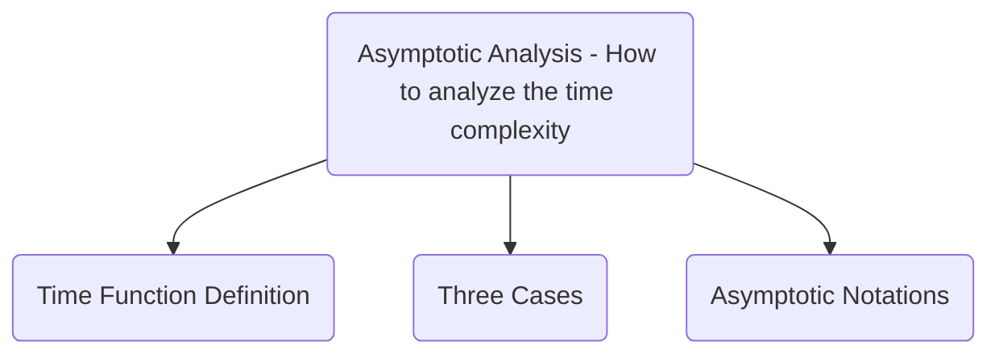

# Selection Sort Research Report

## Executive Summary

## Algorithm

### <ins>Selection Sort</ins>
1.  Get a list of unsorted elements `LIST`
2. Iterate through the list storing the current index as `CURRENT`.
3. Store the value of the `CURRENT` index in `TEMP`
	`TEMP = LIST[CURRENT]`
4. Iterate through the remaining items in the list to find the lowest value and store the index of that item as `LOWEST_IDX` 
5. Move the value of the item at `LOWEST_IDX` to the item at `CURRENT` 
    `LIST[CURRENT] = LIST[LOWEST_IDX]`
6. Move the value `TEMP` to the item at `LOWEST_IDX`
    `LIST[LOWEST_IDX] = TEMP`

### Pseudocode
```
input LIST
for CURRENT from 0 to length(LIST) do
	TEMP <- LIST[CURRENT]
	LOWEST_IDX <- CURRENT
    for SEARCH from CURRENT to length(LIST) do
	    if LIST[SEARCH] < LIST[LOWEST_IDX] then
		    LOWEST_IDX <- SEARCH
	    endif
    endfor
    LIST[CURRENT] <- LIST[LOWEST_IDX]
    LIST[LOWEST_IDX] <- TEMP
endfor
return LIST
```

### Implementation Example (Python)
```python
def selection_sort(l):
    for c in range(len(l)):
        tmp = l[c]
        lowest_idx = c
        for s in range(c, len(l)):
            if l[s] < l[lowest_idx]:
                lowest_idx = s
        l[c] = l[lowest_idx]
        l[lowest_idx] = tmp
    return l
```

<div style="page-break-after: always;"></div>

## Asymptotic Analysis



### Time Function Definition
```c
void function(int n[]) {                    // T(n)
	int i, j, tmp, lowest_idx;              // 4
	for (i = 0, i < sizeof(n), i++) {       // n + 1
		tmp = n[i]                          // n
		lowest_idx = i                      // n
		for (j = i, j < sizeof(n), j++)     // n * (n + 1)
			if n[j] < n[lowest_idx]         // n * n
				lowest_idx = j              // n * n
		l[i] = l[lowest_idx]                // n
		l[lowest_idx] = tmp                 // n
	}
}
```

$T(n) = 4 + (n + 1) + n + n + (n * (n + 1)) + n^2 + n^2 + n + n$

$T(n) = 3n^2 + 6n + 5$

#### Asymptotic Analysis Rule #1
(keeping only term with highest degree)

$T(n) = 3n^2$

#### Asymptotic Analysis Rule #2
(ignore constants)

$T(n) = n^2$

<div style="page-break-after: always;"></div>

### Three Cases
> [!NOTE]
> **Time Function Key**
> $1 <logn < \sqrt{n} < n < \dots < n^2 < n^3 < \dots < 2^n < 3^n < \dots < n^n$
#### Big O
Worst Case: Reverse Sorted List
> [!TIP]
> **Big O Definition**
> The function $f(n) = O(g(n)) \iff \exists$ two Constants $C$ and $k$ such that:
>  $\quad f(n) <= C \cdot g(n) \quad \forall n >= k$

$n^2 <= C \cdot g(n) \quad \forall n >= 1$
$n^2 <= n^2$ where $C$ =1 and $g(n) = n^2$

From the definition $n^2 = O(n^2)$
#### Big $\Omega$ 
Best Case: Sorted List
> [!TIP]
> **Big $\Omega$ Definition**
> The function $f(n) = \Omega(g(n)) \iff \exists$ two Constants $C$ and $k$ such that:
>  $\quad f(n) >= C \cdot g(n) \quad \forall n >= k$

$n^2 >= C \cdot g(n) \quad \forall n >= 1$
$n^2 >= n^2$ where $C$ =1 and $g(n) = n^2$

From the definition $n^2 = \Omega(n^2)$
#### Big $\Theta$
Average Case: Unsorted List
> [!TIP]
> **Big $\Theta$ Definition**
> The function $f(n) = \Theta(g(n)) \iff \exists$  three Constants $C_1$, $C_2$, and $k$ such that:
>  $\quad C_1 \cdot g(n) <= f(n) <= C_2 \cdot g(n) \quad \forall n >= k$

$C_1 \cdot g(n) <= n^2 <= C_2 \cdot g(n)$

$n^2 <= n^2 <= n^2 \quad \forall n >= 1$ where $C_1 = 1, C_2 = 1$ and $g(n) = n^2$

Based on the definition $n^2 = \Theta(n)$

#### Three Cases Conclusion

The Selection Sort Algorithm has an *exact bound* since $\Omega(n^2)$, $\Theta(n^2)$, and $O(n^2)$.  Therefore, the time complexity is *quadratic* by definition.

<div style="page-break-after: always;"></div>

### Asymptotic Notations
