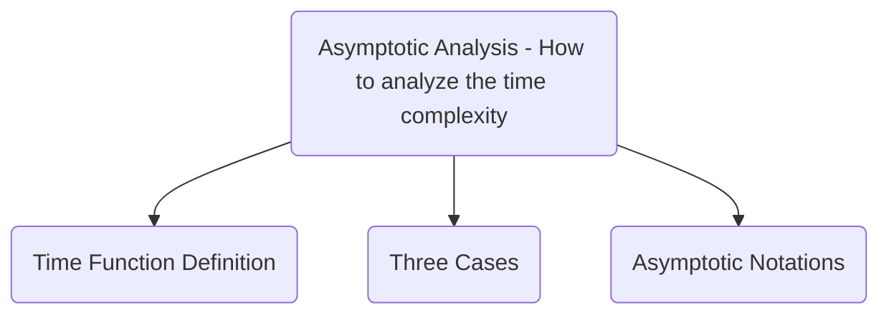

# Selection Sort Research Report

## Executive Summary

*more to come*

## History

Selection Sort is one of the oldest sorting algorithms in Computer Science.  Because of its simplicity, there is no known original author or documented first-use of the algorithm.   

## Use Cases

While not often used as a general purpose sorting algorithm in modern computing today, Selection Sort does still have its uses in both education and industry.  Due to the inherent simplicity of the algorithm, it is still widely used in Computer Science education.   While not as fast as other more modern sorting algorithms in terms of overall time-complexity, Selection Sort still has a real-world use on certain embedded systems that have very expensive memory write operations.  Because the values in the list will only ever be moved (swapped) a maximum of **one time** by the sorting algorithm, this gives Selection Sort an $O(n)$ time complexity it terms of swap operations.

## Comparison to Other Sorting Algorithms

To illustrate the unique value of Selection Sort when compared to other sorting algorithms, we must look at the Worst Case Time Complexity **specifically for Swap Operations**:

| Sorting Algorithm     | Worst Case (For Swap Operations) |
| --------------------- | -------------------------------- |
| Selection Sort        | $O(n)$                           |
| Bubble Sort           | $O(n^2)$                         |
| Recursive Bubble Sort | $O(n^2)$                         |
| Quicksort             | $O(nlogn)$                       |
| Insertion Sort        | $O(n^2)$                         |
| Bucket Sort           | N/A - not an in-place sort       |
| Radix Sort            | N/A - not an in-place sort       |
| Count Sort            | N/A - not an in-place sort       |
| Heap Sort             | $O(nlogn)$                       |
| Tree Sort             | N/A - not an in-place sort       |
| Shell Sort            | $O(n^2)$                         |
| TimSort               | N/A - not an in-place sort       |

<div style="page-break-after: always;"></div>

## Algorithm

### <ins>Selection Sort</ins>

1. Iterate through the list `LIST` while storing the current item index as `CURRENT_IDX`.
2. Starting at the current item, Iterate through the remaining items in the list to find the lowest value and store the index of that item as `LOWEST_IDX`
3. If the value stored in the current item does NOT have the lowest value of all the remaining items, then swap the values stored in the current item with the value stored at `LOWEST_IDX`.
    1. Copy the value of the list item stored at `CURRENT_IDX` index to `TEMP`.
        
        `TEMP = LIST[CURRENT_IDX]`
    1. Copy the value of the item at `LOWEST_IDX` to the item at `CURRENT`
        
        `LIST[CURRENT_IDX] = LIST[LOWEST_IDX]`
	1. Copy the value stored in `TEMP` to the item at `LOWEST_IDX`
        
        `LIST[LOWEST_IDX] = TEMP`

### Pseudocode

```
for CURRENT_IDX from 0 to length(LIST) do
    LOWEST_IDX <- CURRENT_IDX
    for SEARCH_IDX from CURRENT_IDX to length(LIST) do
        if LIST[SEARCH_IDX] < LIST[LOWEST_IDX] then
            LOWEST_IDX <- SEARCH_IDX
        endif
    endfor
    if LOWEST_IDX != CURRENT_IDX then
	    TEMP <- LIST[CURRENT_IDX]
        LIST[CURRENT_IDX] <- LIST[LOWEST_IDX]
        LIST[LOWEST_IDX] <- TEMP
    endif
endfor
```

### Implementation Example (Python)

```python
def selection_sort():
    for c in range(len(LIST)):
        lowest_idx = c
        for s in range(c, len(LIST)):
            if LIST[s] < LIST[lowest_idx]:
                lowest_idx = s
        if lowest_idx != c:
	        tmp = LIST[c]
            LIST[c] = LIST[lowest_idx]
            LIST[lowest_idx] = tmp
```

<div style="page-break-after: always;"></div>

## Asymptotic Analysis



### Time Function Definition

```cpp
void T(int n[]) {                            // T(n)
    int i, j, tmp, lowest_idx;               // 4
    for (i = 0; i < sizeof(n); i++) {        // n + 1
        lowest_idx = i;                      // n
        for (j = i; j < sizeof(n); j++)      // n * (n + 1)
            if (n[j] < n[lowest_idx])        // n * n
                lowest_idx = j;              // n * n
        if (lowest_idx != i) {               // n
            tmp = n[i];                      // n
            l[i] = l[lowest_idx];            // n
            l[lowest_idx] = tmp;             // n
        }
    }
}
```

$T(n) = 4 + (n + 1) + n + (n * (n + 1)) + n^2 + n^2 + n + n + n + n$

$T(n) = 3n^2 + 7n + 5$

#### Asymptotic Analysis Rule #1

(keeping only term with highest degree)

$T(n) = 3n^2$

#### Asymptotic Analysis Rule #2

(ignore constants)

$T(n) = n^2$

<div style="page-break-after: always;"></div>

### Three Cases

#### Worst Case

The worst case for time complexity for this algorithm is when **the list is sorted, but in reverse order**.  This will require moving every element.  However, no matter if all the elements are moved or none of them are moved, the time complexity is $O(n^2)$ because of comparison operations.

$T(n) = 4 + (n + 1) + n + (n * (n + 1)) + n^2 + n^2 + n + n + n + n$

$T(n) = 3n^2 + 7n + 5$

$T(n) = 3n^2$

$T(n) = n^2$

See [Big O](#Big%20O) Below

#### Best Case

The best case for Time Complexity for this algorithm is when **the list is already sorted**.
This will not require moving any elements.  However the time complexity is still $O(n^2)$ because of comparison operations.

$T(n) = 4 + (n + 1) + n + (n * (n + 1)) + n^2 + n$

$T(n) = 2n^2 + 4n + 5$

$T(n) = 2n^2$

$T(n) = n^2$

See [Big Omega](#Big%20Omega)

#### Average Case

The average case for Time Complexity for this algorithm is when **the list is unsorted in such a way that half of items must move**.  The time complexity will always be $O(n^2)$ because of the comparison operations.

$T(n) = 4 + (n + 1) + n + (n * (n + 1)) + n^2 + \frac{n^2}{2} + n + \frac{n}{2} + \frac{n}{2} + \frac{n}{2}$

$T(n) = \frac{5n^2}{2} + \frac{11n}{2} + 5$

$T(n) = \frac{5n^2}{2}$

$T(n) = n^2$

See [Big Theta](#Big%20Theta)

<div style="page-break-after: always;"></div>

### Asymptotic Notations

Time Complexity Key:

> [!NOTE]
> $1 <logn < \sqrt{n} < n < \dots < n^2 < n^3 < \dots < 2^n < 3^n < \dots < n^n$

#### Big O

Worst Case: Reverse Sorted List

> [!TIP]
> The function $f(n) = O(g(n)) \iff \exists$ two Constants $C$ and $k$ such that:
>  $\quad f(n) <= C \cdot g(n) \quad \forall n >= k$

$3n^2 + 7n + 5 <= C \cdot g(n) \quad \forall n >= 1$

$3n^2 <= C \cdot g(n) \quad \forall n >= 1$

$n^2 <= C \cdot g(n) \quad \forall n >= 1$

$n^2 <= n^2$ where $C$ =1 and $g(n) = n^2$

From the definition: $O(n^2)$

#### Big Omega

Best Case: Sorted List

> [!TIP]
> The function $f(n) = \Omega(g(n)) \iff \exists$ two Constants $C$ and $k$ such that:
>  $\quad f(n) >= C \cdot g(n) \quad \forall n >= k$

$2n^2 + 4n + 5 >= C \cdot g(n) \quad \forall n >= 1$

$2n^2 >= C \cdot g(n) \quad \forall n >= 1$

$n^2 >= C \cdot g(n) \quad \forall n >= 1$

$n^2 >= n^2$ where $C$ =1 and $g(n) = n^2$

From the definition: $\Omega(n^2)$

#### Big Theta

Average Case: Unsorted List

> [!TIP]
> The function $f(n) = \Theta(g(n)) \iff \exists$  three Constants $C_1$, $C_2$, and $k$ such that:
>  $\quad C_1 \cdot g(n) <= f(n) <= C_2 \cdot g(n) \quad \forall n >= k$

$C_1 \cdot g(n) <= \frac{5n^2}{2} + \frac{11n}{2} + 5 <= C_2 \cdot g(n)$

$2n^2 + 4n + 5 <= \frac{5n^2}{2} + \frac{11n}{2} + 5 <= 3n^2 + 7n + 5$

$2n^2 <= \frac{5n^2}{2} <= 3n^2$

$\frac{2n^2}{5} <= n^2 <= \frac{6n^2}{5}$

$n^2 <= n^2 <= n^2 \quad \forall n >= 1$ where $C_1 = \frac{2}{5}, C_2 = \frac{6}{5}$ and $g(n) = n^2$

From the definition: $\Theta(n^2)$

### Conclusion

The Selection Sort Algorithm has an *exact bound* since $\Omega(n^2)$, $\Theta(n^2)$, and $O(n^2)$.  Therefore, the time complexity is **quadratic** by definition.
